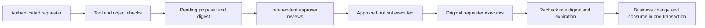

# Agent Security Lab

An AI-assisted educational lab for **server-enforced tool permissions, isolated memory and independent approvals**.

面向 Agent 安全的可复现实验：用合成账号比较“模型提出动作”与“服务器允许执行”的边界，观察越权拦截、记忆隔离和审批防重放。

[Quick start](#quick-start) · [Demo & expected results](#demo-and-expected-results) · [Walkthrough](docs/DEMO.md) · [Threat model](docs/THREAT_MODEL.md) · [Engineering guide](docs/ENGINEERING.md) · [CI](https://github.com/zongemory-spec/agent-security-lab/actions/workflows/tests.yml)

## What this project demonstrates

| Boundary | What enforces it |
| :--- | :--- |
| Tool authorization | Server-side tool / argument allowlists and role checks. |
| Object authorization | Tenant and owner checks before reading synthetic records. |
| High-risk operations | A proposal, an independent approver, then execution by the original requester. |
| Replay prevention | Parameter digest, expiration and one-time transactional consumption. |
| Memory isolation | Tenant / user / session / mode namespaces; preferences never become identity or authority. |
| Repeatable evidence | Offline synthetic tests and deterministic demos; no paid model key required. |

The secure mode is the HTTP demo's default. Earlier vulnerable behavior is preserved only as an explicitly labeled teaching comparison; see the [threat model](docs/THREAT_MODEL.md) before interpreting the results.

## Quick start

Use **Python 3.12** from the repository root:

```sh
python -m venv .venv
```

| Shell | Activate the environment |
| :--- | :--- |
| Windows PowerShell | `.\.venv\Scripts\Activate.ps1` |
| macOS / Linux | `source .venv/bin/activate` |

```sh
python -m pip install -r requirements.lock
python init_demo.py
python -m uvicorn api:create_app --factory --host 127.0.0.1 --port 8002 --no-access-log
```

Open **http://127.0.0.1:8002**. Use the tokens generated in local `data/demo_auth.json`; never publish this file or put tokens in screenshots. The default model is a deterministic mock.

The [browser walkthrough](docs/DEMO.md) shows which local identity to use, what to click and what each result means. Real providers are optional and may be billable; configure them separately using the [engineering guide](docs/ENGINEERING.md).

## Demo and expected results

For a quick demonstration without a browser, run:

```sh
python deterministic_security_demo.py
python deterministic_memory_demo.py
```

These scripts use disposable temporary databases and synthetic users. They do not require tokens, contact model providers or delete any real user.

| Scenario | Expected result |
| :--- | :--- |
| Alice reads Alice's salary | Allowed for the synthetic record. |
| Alice requests Bob's salary | `object_permission_denied`. |
| Operator requests deletion | A pending proposal; the tool does not execute the deletion. |
| Two calls execute the same approved proposal | One `consumed`; one `action_not_approved`. Ordering can vary. |
| Alice writes a secure preference | Alice can read it; Bob's secure memory remains empty. |
| Vulnerable / secure memory comparison | Demonstration data in vulnerable mode stays separate from secure namespaces. |

See [the detailed walkthrough](docs/DEMO.md) for the output fields and an interactive approval exercise.

## Approval flow



The model cannot approve or execute a high-risk action through its tool list. Approval and execution are separate steps; a remembered claim such as “Alice is admin” does not change the server's identity registry.

## Checks

```sh
python -m unittest discover -s tests -v
python deterministic_security_demo.py
```

The [GitHub workflow](.github/workflows/tests.yml) runs these offline checks. Inspect its actual result for the commit you are reviewing. Tests include an isolated vulnerable legacy fixture; a successful test of vulnerable behavior is teaching evidence, not a recommendation to run that mode publicly.

## Threat model and limits

Trust is placed in server code, startup configuration, credential mapping, SQLite files and the operating-system account. Request text, retrieval text, memory values and model tool suggestions are untrusted.

- Local demo authentication is not production SSO or a remote identity service.
- Namespace isolation and key allowlists do not prevent every possible prompt injection.
- Redaction is not a complete data-loss-prevention system.
- Host compromise, resource exhaustion, encrypted backups and production data retention are outside this experiment.
- Synthetic regression checks do not establish a model attack-success rate or certify security.

Keep the demo bound to localhost. Read [the complete threat model](docs/THREAT_MODEL.md) and [engineering notes](docs/ENGINEERING.md) for trusted components, known gaps and migration choices.

## Code map

| Files | Responsibility |
| :--- | :--- |
| `agent.py`, `llm_client.py` | Bounded tool loop and optional provider adapter |
| `auth.py`, `security.py`, `tools.py` | Server identity, policy and object access |
| `approvals.py`, `storage.py` | Independent approval and transactional execution |
| `memory.py` | Scoped, untrusted preferences |
| `tests/`, `deterministic_*_demo.py` | Synthetic regression cases and repeatable demonstrations |

## Development and provenance

This project was developed with AI assistance. [Source history](docs/SOURCE_HISTORY.md) explains the imported snapshots and original records; commits are not backdated. Tags `snapshot/v1`, `snapshot/v2`, `snapshot/v2.1-engineering`, `snapshot/v3` and `snapshot/v3.1` preserve earlier work; reconstructed original records remain on `archive/*` branches.

See [historical notes](README.legacy.md) and [contribution guidance](CONTRIBUTING.md). Use synthetic examples in reports and never upload credentials, private records or generated databases.
