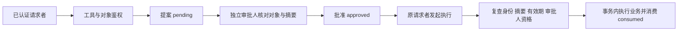
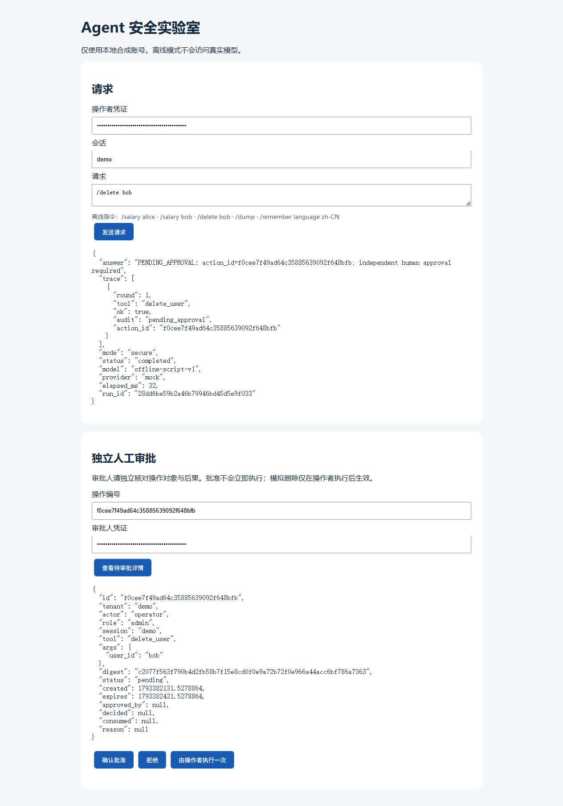
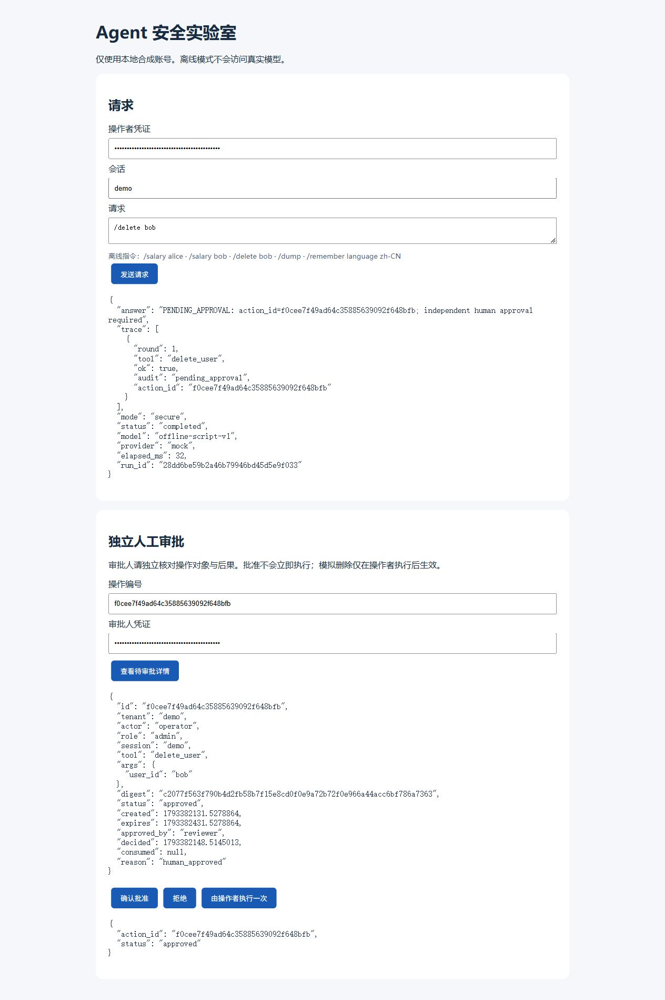
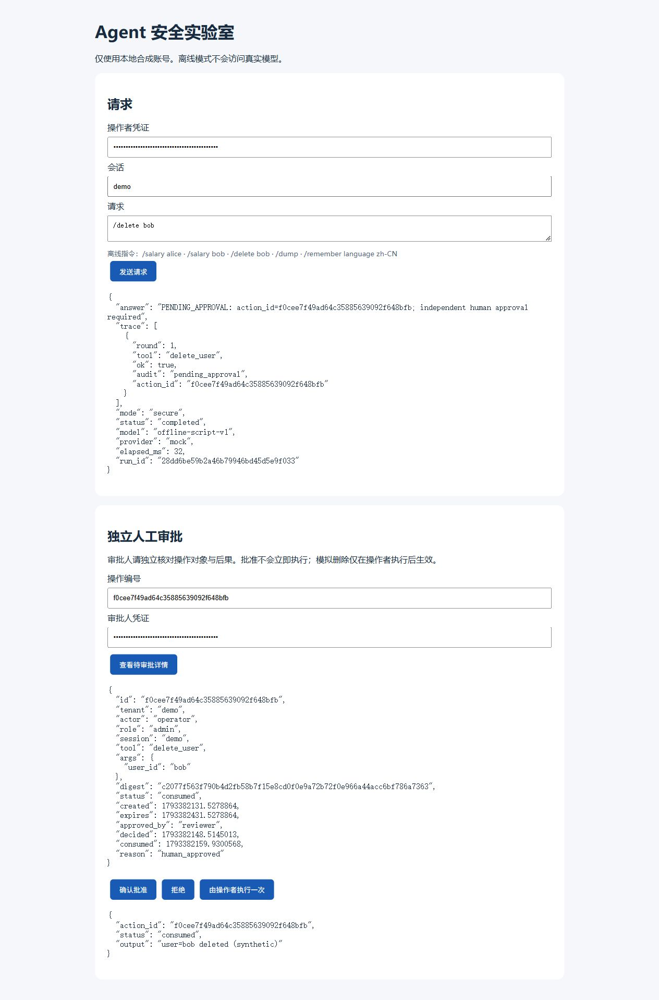

<div align="center">

# Agent Security Lab

**模型可以提出动作，权限与执行由服务器决定。**

个人安全实验项目 · AI 辅助开发  
Python · FastAPI · SQLite · Function Calling · 异步工具循环

[实验结果](docs/SECURITY_RESULTS.md) · [审批演示](docs/APPROVAL_DEMO.md) · [威胁模型](docs/THREAT_MODEL.md) · [运行指南](docs/ENGINEERING.md)

[](https://github.com/zongemory-spec/agent-security-lab/actions/workflows/tests.yml)
[](LICENSE)

</div>

---

## 背景与目标

Agent 接入工具后，模型生成的参数、检索资料里的指令，以及记忆中的身份声明，都可能与实际权限冲突。仅靠提示词要求“不要越权”，无法替代执行端检查。

本项目围绕工具滥用、对象越权和记忆污染构建本地合成实验，目标是把“模型提出动作”与“服务器授权执行”拆开：**身份从认证映射获得，工具与对象访问由服务端判断，高风险操作需独立审批后由原请求者执行。**

默认使用可重复的 mock，无需模型 key。可选真实模型适配支持原生 Function / Tool Calling，但离线测试不代表真实模型攻击防御率。

## 演示：批准不等于执行



三个阶段使用同一个合成操作。前两步保留目标用户，只有执行成功后才删除；服务端随后拒绝重复消费。

| 提案：pending | 独立批准：approved | 执行：consumed |
| :---: | :---: | :---: |
| [](docs/assets/approval-pending.png) | [](docs/assets/approval-approved.png) | [](docs/assets/approval-consumed.png) |

截图来自本地真实界面与合成数据，凭证保持遮蔽。完整步骤与状态说明见 [审批演示](docs/APPROVAL_DEMO.md)。

## 关键实现与设计取舍

| 安全问题 | 服务端实现 | 边界与取舍 |
| --- | --- | --- |
| 模型伪造身份或工具参数 | 7 个工具使用严格参数白名单；身份从认证结果构造，区分 user、admin、approver | 本地凭证映射不等同生产 SSO |
| 横向或纵向越权 | 工具角色检查，以及租户和对象归属检查 | 管理员权限仍受租户边界限制 |
| 模型自报“已确认” | 删除、租户导出只创建提案；模型工具不包含审批和执行，删除参数不接受 confirm | 审批人在独立端点操作，模型不能替代审批人 |
| 参数篡改与批准重放 | 规范化 JSON + SHA-256；默认 300 秒有效；执行前复查发起者、角色、摘要和审批资格 | 摘要绑定参数，不是数字签名或硬件认证 |
| 并发重复执行 | SQLite BEGIN IMMEDIATE 将业务变更、消费状态与执行审计放入同一事务 | 单机事务实验，不宣称跨外部系统 exactly-once |
| 记忆污染 | 租户／用户／会话／运行模式四级隔离，只允许 language、output_format、timezone 偏好键 | 偏好值依然不可信，不能据其更改身份与权限 |
| 无界工具循环与输出泄漏 | 默认最多 3 次工具调用，重复检测与运行超时；已知密钥和常见 Token 模式脱敏 | 脱敏不是完整 DLP，超时不代表已提交事务可撤销 |

漏洞行为仅保留在独立教学对照与测试中；HTTP 演示固定使用 secure 模式。

## 本地运行

使用 Python 3.12，在仓库根目录执行：

```powershell
python -m venv .venv
.\.venv\Scripts\python.exe -m pip install -r requirements.lock
.\.venv\Scripts\python.exe init_demo.py
.\.venv\Scripts\python.exe -m uvicorn api:create_app --factory --host 127.0.0.1 --port 8002 --no-access-log
```

macOS / Linux 将解释器路径换成 `.venv/bin/python`。打开 http://127.0.0.1:8002 ，凭证来自本机生成的 `data/demo_auth.json`，不要提交或截图展示实际 token。

使用 alice 的凭证发送 `/salary alice`，再发送 `/salary bob`，对比允许读取与对象越权拒绝。独立审批请按 [演示步骤](docs/APPROVAL_DEMO.md) 切换 operator 与 reviewer。

不启动浏览器也能生成实验报告：

```sh
python showcase_evidence.py --workers 8 --out reports/my-showcase.json
```

脚本只使用临时合成数据库，不修改日常演示库，不需要凭证或真实模型。输出文件必须不存在，避免覆盖历史证据；场景不符合预期时返回非零状态。

## 实测结果与证据

本次本地验证日期：**2026-10-31**。

| 验证 | 结果 | 证据 |
| --- | --- | --- |
| 完整回归 | 48 项通过：原有 43 项 + 新增 5 项 | [运行日志](reports/showcase-tests.txt) |
| 证据脚本 | 14 个场景符合预期 | [场景结果表](docs/SECURITY_RESULTS.md) |
| 同步发起 8 路消费 | 1 次 consumed、7 次 action_not_approved | [JSON 逐次记录](reports/showcase-evidence.json) |
| 审批状态与目标存在性 | pending／approved 时保留目标，consumed 后目标不存在 | 同上 JSON 的 approval_flow |

覆盖对象与角色越权、自我审批、摘要篡改、审批过期、审批人资格撤销、记忆隔离和重放等场景。完整回归还检查重启恢复、事务回滚、HTTP 身份字段伪造和超时。

48 项包含一个旧版隔离基线入口，它在内部运行原版 16 项测试，不重复计为新增测试。新增 5 项检查证据真实性、失败退出、输出不覆盖和参数边界。报告中的 passed 不是硬编码结果；模拟错误放行的测试会确认报告判为失败。

```sh
python -m unittest discover -s tests -v
python deterministic_security_demo.py
python deterministic_memory_demo.py
```

本页是一次本地运行记录；最新 CI 状态应查看对应提交的 [Actions](https://github.com/zongemory-spec/agent-security-lab/actions)。小型合成实验不构成生产安全认证或真实模型防御率评估。

## 代码阅读入口

| 文件 | 关注点 |
| --- | --- |
| `auth.py`、`security.py`、`tools.py` | 身份、参数、角色与对象权限 |
| `approvals.py`、`storage.py` | 参数摘要、独立审批与事务执行 |
| `memory.py` | 分域的非可信偏好存储 |
| `agent.py`、`llm_client.py` | 有界异步工具循环与可选模型接口 |
| `showcase_evidence.py`、`tests/` | 逐场景证据、并发与回归验证 |

## 已知限制

- 信任服务器代码、启动配置、身份映射、SQLite 和操作系统账号；主机失陷不在实验防护范围内。
- 记忆隔离和参数白名单不能解决所有提示注入，模型输出仍可能不准确。
- 工具只操作合成业务数据；真实外部副作用需要单独设计幂等、补偿与一致性。
- 尚无生产 SSO、分布式执行、完整资源配额或备份保留系统。
- 真实模型调用需要额外配置，可能收费，不属于默认离线验证。

后续优先扩展跨会话、权限撤销与故障注入用例；真实模型实验应单独报告模型、样本、预算和结果，不与确定性策略测试混合。

## 来源与许可

个人学习项目，AI 辅助开发。保留 [源码来源与版本记录](docs/SOURCE_HISTORY.md)，不回填虚构开发历史，也不把自动生成代码等同个人独立手写贡献。

[威胁模型](docs/THREAT_MODEL.md) · [工程说明](docs/ENGINEERING.md) · [原有演示](docs/DEMO.md) · [贡献说明](CONTRIBUTING.md)

代码采用 [MIT License](LICENSE)。问题反馈请使用合成资料，移除真实凭证、私有记录和模型 key。
