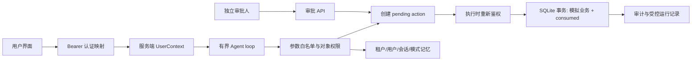

# Agent Lab 工程版：启动与验收

本轮按执行计划 L0–L5 实施。原项目未提交的 README 内容完整保留在其历史说明区与本地基线。默认离线、secure；不使用真实模型密钥，不执行真实账号删除。

## 10 分钟启动（Python 3.12）
```powershell
python -m venv .venv-engineering
.\.venv-engineering\Scripts\python.exe -m pip install -r requirements.lock
.\.venv-engineering\Scripts\python.exe init_demo.py
.\.venv-engineering\Scripts\python.exe -m uvicorn api:create_app --factory --host 127.0.0.1 --port 8000 --no-access-log
```
打开 http://127.0.0.1:8000 。本地凭证在 data/demo_auth.json，自行打开并复制对应 token 到页面；不要提交或分享该文件。普通用户 alice/bob，发起人 operator（admin），审批人 reviewer（approver）。文件权限依赖操作系统；Windows 请使用个人目录的访问控制。它是本地演示认证，不是生产登录系统。

初始化只在数据库首次创建时填充合成用户；再次启动不会复活已删除的用户。可通过 LAB_DB 和 LAB_AUTH_FILE 指定另一个全新实验目录。旧 data/memory.json 不迁移、不读取，不会覆盖原 .env。初始化脚本是 v1 schema 入口；未知 schema 版本拒绝启动。

## 四段演示，约 3 分钟
1. alice 凭证发送 /salary alice：30000。
2. alice 发送 /salary bob：后端 object_permission_denied。请求成功到达 Agent，HTTP 为 200，拒绝是结构化工具结果；接口本身越权（审批、日志）是 403。
3. operator 发送 /delete bob：只有 pending action。下方输入 reviewer 凭证并查看详情，核对 actor、tool、args、digest、到期时间；点击确认批准，再由 operator 点击执行。第二次执行返回 409。operator 不能自批。
4. alice 发送 /remember language zh-CN；bob 使用同样 session 不能获得 alice 记忆。运行 deterministic_memory_demo.py 查看跨用户、跨模式隔离。
独立确定性演示：python deterministic_security_demo.py。所有演示只操作 SQLite 合成记录。
当前未制作真人讲解录屏；本节为录屏脚本，不表示用户已完成学习或演示。

## 架构

模型 schema 中没有角色、租户、confirm、approve 或 execute。高风险操作在后端 pending→approved/rejected/expired→consumed；同一事务中更新业务和消费状态。SHA-256 摘要用于绑定参数，不是认证 token。

## 测试
```powershell
.\.venv-engineering\Scripts\python.exe -m unittest discover -s tests -v
```
原始 16 项测试连同原始源码保存在 tests/fixtures/legacy_v2.zip；测试会在临时目录运行这些原始测试。它们包含旧的脆弱行为断言，不能拿来证明新版安全。新版回归单独验证不再接受 confirm。所有当前状态每例重新创建。
覆盖：身份、对象、缺参/额外字段/类型、双人审批、参数篡改、过期、拒绝、重放、8 并发请求只有一次执行、事务故障回滚、重启、记忆命名空间、429、超时、工具循环/调用上限、脱敏和运行记录权限。
GitHub Actions 配置已提供；没有替你推送代码或声称远端 CI 已执行。

## 真实模型与离线工程测试分开
默认 LAB_MODEL=mock 是脚本模拟器，支持页面列出的 /指令，不是自然语言推理模型。
显式设置 LAB_MODEL=real 后才读取原 .env 并使用 Qwen/DeepSeek HTTP 兼容接口；每次请求有网络超时，无自动重试，Agent 总时限 30 秒，默认最多 3 次工具调用。真实接口、费用与防御成功率本轮未测。
离线 CLI：python app.py；真实 CLI：python app.py --provider qwen。
脆弱对照只能本地显式启动：python app.py --mode vulnerable --allow-vulnerable，使用独立 cli_vulnerable.sqlite3；HTTP 不提供模式切换。
实验记录建议：模型版本、日期、参数、用例、重复次数、API 异常、实际 usage/价格。攻击成功率和后端拦截率分开，分母为零写不适用，API 错误单列。不要以测试数宣称“100% 安全”。

## 容器与源码导出
docker compose up --build；仅映射 127.0.0.1:8000。使用命名卷保存本地凭证与状态；凭证需在容器数据文件中由本机用户查看。不要公开端口。
python package_source.py 创建 dist/agent-security-engineering.zip。白名单不含 .env、.venv、运行数据、个人笔记或真实日志。
容器运行结果见交付记录；配置文件存在不代表本机已经运行过 Docker。

## 参考
FastAPI TestClient：https://fastapi.tiangolo.com/tutorial/testing/
SQLite 事务：https://docs.python.org/3.12/library/sqlite3.html

